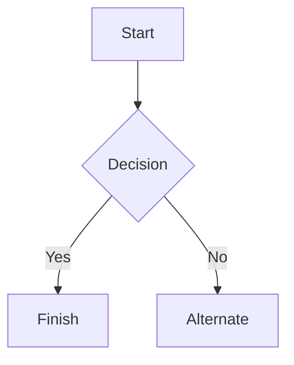

Documentation of my first attempt at creating a honeypot. 
# Honey via Cowrie
## Features
### Choisir d'utiliser un shell simulé (par défaut):
  Créer un faux shell avec les dossier classique d'un Debian 5.0 avec les commandes cd, ls, etc. fonctionnelles (pas toutes evidement). 
  Il y également la possibilitée de créer des faux fichiers à l'intérieur de ce shell simulé.    
  Si un attaquant cherche à mettre un virus à l'interieur du shell simulé, cowrie va le stopper et stocké ces fichiers dans un dossier spécial.
### Ou un Proxy SSH et telnet vers un autre serveur (plus  grande infrastructure)
Il accepte la connexion de l'attaquant, mais la redirige discrètement vers un vrai serveur isolé pendant que cowrie écoute tout ce qu'il fait. 
### Or use an LLM backend (experimental):
Pas utilisé mais le principe est que le shell est simulé par ChatGPT pour que toutes les commandes puissent être simulé et pas seulement celle prévu par défaut. 
## Installation
```
$ docker run -p 2222:2222 cowrie/cowrie:latest   
$ ssh -p 2222 root@localhost  
```
**avec -p [le port simulé]:[le vrai port de cowrie]**
```
$ make docker-build    
```
**Pour le faire tourner localement**

## Commands
* cowrie - start, stop and restart Cowrie
* fsctl - modify the fake filesystem
* createfs - create your own fake filesystem 
* playlog - utility to replay session logs
* asciinema - turn Cowrie logs into asciinema files

## Editing the pickle file
*pickle file, est l'ensemble des "faux fichiers" pour simuler une debian plus réaliste*

**A faire, voir pour docker**

### Lier Cowrie à Prometheus

1. Créer le réseau docker
```
docker network create cowrie-net
```
2. Préparer la taille de prometheus et sa configuration
```
docker volume create prometheus-data
```
```
sudo mkdir -p /etc/prometheus
sudo cp ./docs/prometheus/prometheus.yaml /etc/prometheus/prometheus.yaml
```
3. Démarrer Prometheus sur cowrie-net
```
docker run -d \
  --name prometheus \
  --network cowrie-net \
  -p 9090:9090 \
  -v /etc/prometheus/prometheus.yaml:/etc/prometheus/prometheus.yaml:ro \
  -v prometheus-data:/prometheus \
  prom/prometheus \
  --config.file=/etc/prometheus/prometheus.yaml
```
_On peut vérifier que cela marche à l'adresse : http://localhost:9090/targets_     

4. Lancer cowrie avec les métriques de Prometheus
```
docker run -d \
  --name cowrie \
  --network cowrie-net \
  -p 2222:2222 \
  -p 9000:9000 \
  -e COWRIE_OUTPUT_PROMETHEUS_ENABLED=yes \
  cowrie/cowrie:latest
```
5. Lancer node-exporter (métrique de l'hôte)
```
docker run -d \
  --name node-exporter \
  --network cowrie-net \
  --pid host \
  -v /:/host:ro \
  -p 9100:9100 \
  quay.io/prometheus/node-exporter:latest \
  --path.rootfs /host
```
6. Lancer cAdvisor (métrique du docker)
```
docker run -d \
  --name cadvisor \
  --network cowrie-net \
  --privileged \
  -v /:/rootfs:ro \
  -v /var/run:/var/run:rw \
  -v /sys:/sys:ro \
  -v /sys/fs/cgroup:/sys/fs/cgroup:ro \
  -v /var/lib/docker/:/var/lib/docker:ro \
  -p 8080:8080 \
  gcr.io/cadvisor/cadvisor:latest
```
7. Lancer Prometheus localement
```
[output_prometheus]
enabled = true
port = 9000
debug = false
```
8. Vérification 
```
global:
  scrape_interval: 5s
scrape_configs:
  - job_name: 'cowrie'
    static_configs:
      - targets: [
        'localhost:9000',
      ]
  - job_name: 'scrapers'
    static_configs:
      - targets: [
        'node-exporter:9100',
        'cadvisor:8080'
      ]
    metric_relabel_configs:
      - source_labels: [ cowrie ]
        regex: '^cowrie$'
        action: keep
      - action: drop
        regex: '.*'
```
_Il faut que prometheus.yaml est contiennent ces lignes çi-dessus_    
_Si nécessaire nous pouvons redémarrer Prometheus et regarder à [Status --> Targets] pour vérifier que les 3 sont "up"_
## Démarrage automatique

**A faire, une fois le docker testé**

## Intégration de TotalVirus    


## Files of interest:    
* etc/cowrie.cfg - Cowrie's configuration file (operator-owned). Created by cowrie init.   
*  src/cowrie/data/etc/cowrie.cfg.dist - bundled defaults, edit your etc/cowrie.cfg instead   
* etc/userdb.txt - credentials to access the honeypot   
* src/cowrie/data/fs.pickle - fake filesystem; carries both metadata (path, uid, gid, size, mode) and the embedded contents (A_CONTENTS bytes) for the small files attackers commonly cat. Edit via fsctl; rebuild via make build-fs-pickle.
* src/cowrie/data/txtcmds/ - output for simple fake commands
* var/log/cowrie/cowrie.json - audit output in JSON format
* var/log/cowrie/cowrie.log - log/debug output
* var/lib/cowrie/tty/ - session logs, replayable with the playlog utility.
* var/lib/cowrie/downloads/ - files transferred from the attacker to the honeypot are stored here

## Tables

| Left columns  | Right columns |
| ------------- |:-------------:|
| left foo      | right foo     |
| left bar      | right bar     |
| left baz      | right baz     |


## Mermaid diagrams


## Première étape
Changer le port de SSH (dans etc/ssh/ssh_config), prendre un port après 4951
Redémarrer le service SSH pour appliquer les changements
## Deuxième étape
//
Tu as fait : changer le nom du "serveur" cowrie en un nom crédible, sauverger les logs
Quand j'aurais plus de RAM, lié le SIEM (Wazuh) en docker "single-node" ainsi que le monitor de perfs Prometheus. Virus Total est également à faire (ta clé API est compliqué à cacher)
Egalement il te manque le fichier pickle, (grafana mais ça va de pair avec Prometheus) et création de GIF des commandes rentrées par un attaquant. 
